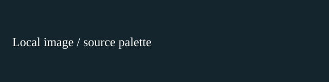

# Portable Markdown theme

A real GFM rendering with **strong**, *emphasis*, ~~deleted text~~, `inline code`,
a [keyboard-focusable link](https://example.org), and https://example.org/autolink.

## Lists and tasks

- Parent
  - Nested child
    1. Ordered grandchild
- [x] Completed task
- [ ] Open task

> A quotation with **emphasis**.
>
> > A nested quotation.

### Tables

| Left | Center | Right |
| :--- | :---: | ---: |
| Alpha | Beta | 123 |
| Second | Stripe | 456 |

```javascript
// Actual offline Prism highlighting
function answer(value = 42) {
  return "answer: " + value;
}
```

```python
def answer():
    return "gold", 32
```

#### Heading four
##### Heading five
###### Heading six

---



<details><summary>Disclosure</summary>Keyboard: <kbd>Ctrl</kbd> + <kbd>F</kbd>.
Subscript H<sub>2</sub>O and superscript x<sup>2</sup>.</details>

<script>window.unsafeMarkdownExecuted = true</script>

<a href="javascript:alert(1)">Unsafe URL becomes harmless text</a>

| Column 1 | Column 2 | Column 3 | Column 4 | Column 5 | Column 6 | Column 7 | Column 8 | Column 9 | Column 10 | Column 11 | Column 12 |
| --- | --- | --- | --- | --- | --- | --- | --- | --- | --- | --- | --- |
| Wide table value 0 | Wide table value 1 | Wide table value 2 | Wide table value 3 | Wide table value 4 | Wide table value 5 | Wide table value 6 | Wide table value 7 | Wide table value 8 | Wide table value 9 | Wide table value 10 | Wide table value 11 |
